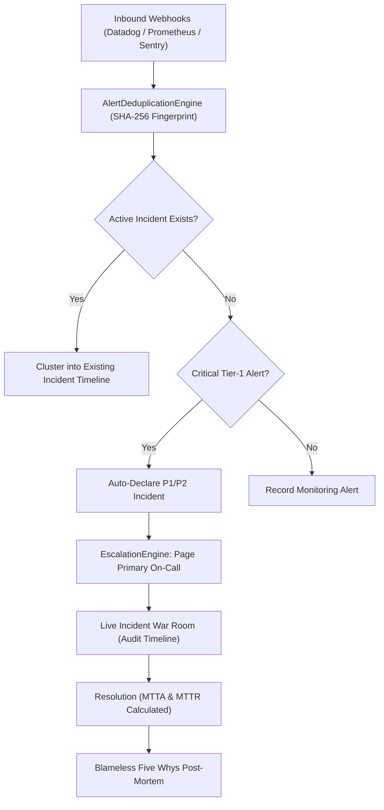

# OpsPulse 🚨
### Enterprise Incident Response, On-Call Scheduling & Service Reliability Platform

[](LICENSE)
[](https://nextjs.org/)
[](https://react.dev/)
[](https://www.typescriptlang.org/)
[](https://www.prisma.io/)
[](https://vitest.dev/)

**OpsPulse** is a mission-critical, enterprise-grade incident management and reliability platform designed for modern SRE, DevOps, and Platform Engineering teams. It unifies alert ingestion across Datadog, Prometheus, Sentry, and CloudWatch, auto-clusters noisy alert floods, enforces guaranteed on-call escalation response SLAs, powers real-time war room coordination, and automates blameless Five Whys post-mortems.

---

## 🌟 Key Features

- **Intelligent Alert Deduplication**: Deterministic SHA-256 fingerprinting normalizes dynamic container IPs, ephemeral pod hashes, and UUIDs to reduce alert fatigue by up to 90%.
- **Multi-Tier Escalation Ladders**: Configurable timeout-based escalation state machine (Primary On-Call -> Secondary SRE -> Engineering Director).
- **Live Incident War Room**:
  - Real-time status progression (`TRIGGERED` -> `ACKNOWLEDGED` -> `INVESTIGATING` -> `IDENTIFIED` -> `MONITORING` -> `RESOLVED`).
  - Integrated Slack war room channels and Zoom/Meet conference links.
  - Chronological timestamped event audit log for compliance and post-incident reconstruction.
- **Service Catalog & SLO Error Budgets**:
  - Microservices tiering (Tier-1 Mission Critical, Tier-2, Tier-3).
  - Continuous SLO availability math (e.g. 99.95% target over 30 days) with real-time error budget burn rate tracking.
  - Upstream and downstream critical dependency topology.
- **Blameless Post-Mortem & Five Whys Hub**:
  - Structured retrospectives with root cause analysis and chronological Five Whys chains.
  - Action items tracker with assignees and priority enforcement.
- **Zero-Setup Local Dev**: Pre-configured SQLite engine with immediate PostgreSQL/MySQL production readiness via Prisma ORM.

---

## 📐 Architecture & Incident Lifecycle



---

## 🚀 Quickstart

### Prerequisites
- Node.js 18.18+ or Node.js 20+
- npm, yarn, or pnpm

### 1. Clone & Install
```bash
git clone https://github.com/yhajizada/opspulse.git
cd opspulse
npm install
```

### 2. Environment Configuration
Create a `.env` file from `.env.example`:
```bash
cp .env.example .env
```
Default configuration:
```env
DATABASE_URL="file:./dev.db"
NODE_ENV="development"
PORT=3000
NEXT_PUBLIC_APP_URL="http://localhost:3000"
OPSPULSE_API_KEY="ops_live_your_api_key_here"
```

### 3. Initialize Database & Seed Demo Data
```bash
npx prisma db push
node prisma/seed.js
```

### 4. Start Development Server
```bash
npm run dev
```
Open [http://localhost:3000](http://localhost:3000) to view the Operations Command Center.

---

## 🧪 Test Suite

Run the Vitest test suite covering alert deduplication regex normalization, SLO error budget math, and escalation ladder state transitions:
```bash
npm test
```

---

## 📡 REST API Reference

| Endpoint | Method | Description |
|---|---|---|
| `/api/v1/incidents` | `GET` | List incidents with status and severity filters |
| `/api/v1/incidents` | `POST` | Declare new incident and auto-create war room |
| `/api/v1/incidents/:id` | `GET` | Fetch incident details, timeline events, and alerts |
| `/api/v1/incidents/:id` | `PATCH` | Transition status (`ACKNOWLEDGED`, `RESOLVED`, etc.) |
| `/api/v1/incidents/:id/timeline` | `POST` | Post live command note to incident audit log |
| `/api/v1/alerts` | `GET` | Retrieve recently ingested monitoring alerts |
| `/api/v1/alerts` | `POST` | Ingest and deduplicate inbound webhook alert |
| `/api/v1/services` | `GET` | Service catalog with SLO availability and dependencies |
| `/api/v1/analytics` | `GET` | Platform MTTR, MTTA, and 30-day availability telemetry |

---

## 🏢 Pre-Configured Enterprise Services

1. **Payment Gateway API**: Tier-1 mission-critical payment processing (99.99% SLO).
2. **Identity & Auth Service**: Tier-1 OAuth2/OIDC token issuance and policy verification (99.95% SLO).
3. **Order Processing Engine**: Tier-1 checkout state machine and Kafka consumer pipeline (99.90% SLO).
4. **Catalog Search & Discovery**: Tier-2 vector embeddings and ranking service (99.50% SLO).

---

## 📄 License

This project is licensed under the [MIT License](LICENSE).

Authored by **[Yusif Hajizada](https://github.com/yhajizada)**.
